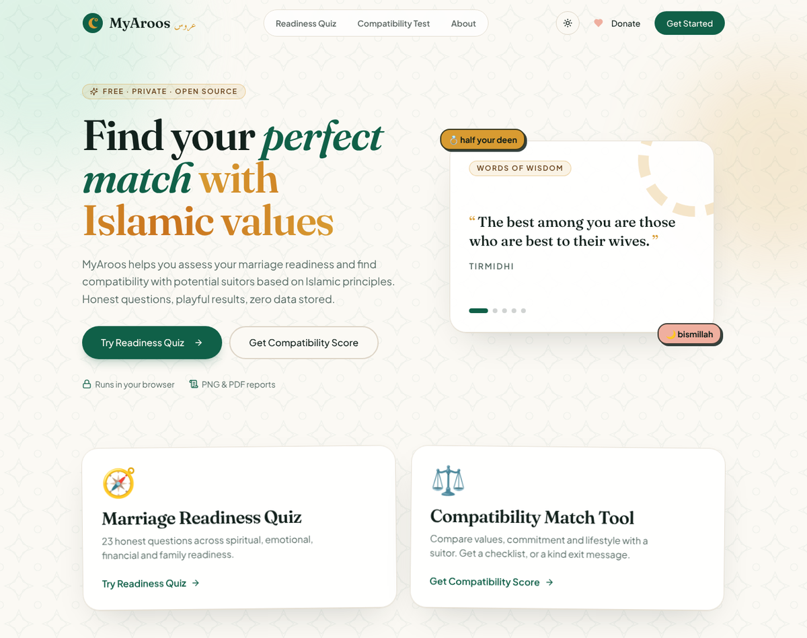
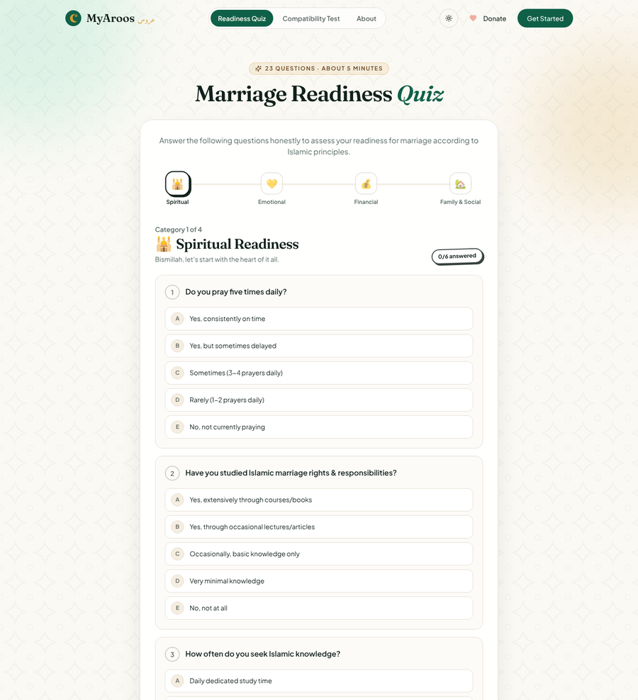
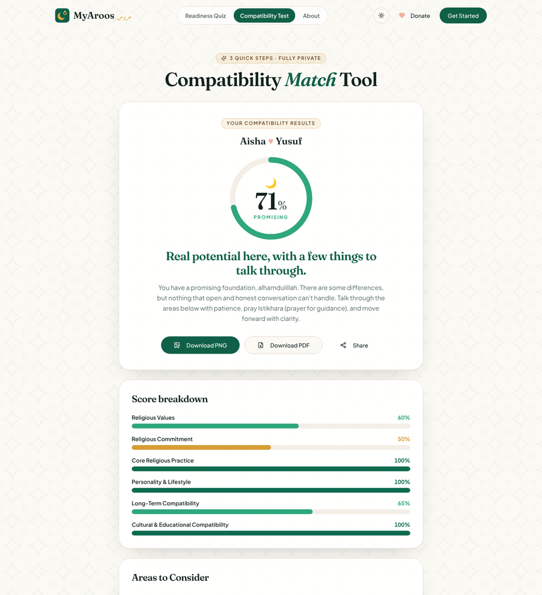
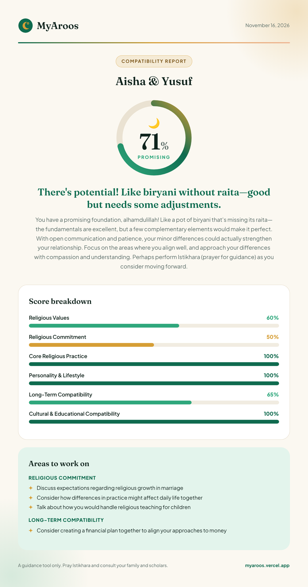
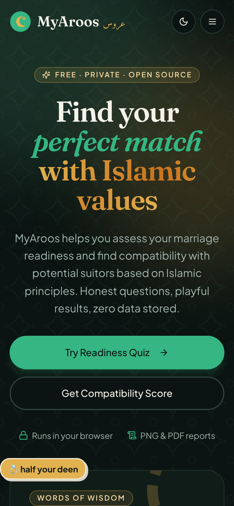

<div align="center">


# MyAroos

**Marriage readiness and compatibility, the halal and fun way.**

An open source web app that helps Muslims check how ready they are for marriage and how compatible they are with a suitor, based on Islamic values. Free, private and runs fully in your browser.

[**Try it live**](https://myaroos.vercel.app) · [Report a bug](https://github.com/kolapoimam/myaroos-matchmaker/issues/new?template=bug_report.yml) · [Request a feature](https://github.com/kolapoimam/myaroos-matchmaker/issues/new?template=feature_request.yml) · [Contribute](CONTRIBUTING.md)


[](https://github.com/kolapoimam/myaroos-matchmaker/actions/workflows/ci.yml)



</div>

## Table of contents

- [Features](#features)
- [Screenshots](#screenshots)
- [Tech stack](#tech-stack)
- [Getting started](#getting-started)
- [Project structure](#project-structure)
- [How scoring works](#how-scoring-works)
- [Contributing](#contributing)
- [Roadmap](#roadmap)
- [Privacy](#privacy)
- [License](#license)

## Features

| | Feature | What it does |
| --- | --- | --- |
| 🧭 | **Marriage Readiness Quiz** | 23 questions across spiritual, emotional, financial and family readiness, one step at a time |
| ⚖️ | **Compatibility Match Tool** | Compares religious values, commitment and lifestyle between you and a suitor |
| 📊 | **Score breakdown** | A score for every category plus practical tips for the weak spots |
| 🖼️ | **Download your report** | Save a clean, branded report as **PNG** or **PDF** |
| 💌 | **Next steps** | An Islamic marriage checklist, or a respectful breakup message if it is not a match |
| 🎉 | **Playful results** | Funny verdicts, animated score rings and a little confetti |
| 🌙 | **Light and dark mode** | Follows your system, with a manual toggle |
| 🔒 | **Private by design** | No accounts, no database. Answers never leave your device |

## Screenshots

| Readiness Quiz | Results |
| --- | --- |
|  |  |

| Downloadable report | Mobile, dark mode |
| --- | --- |
|  |  |

## Tech stack

| Area | Tools |
| --- | --- |
| Framework | [React 18](https://react.dev) with [TypeScript](https://www.typescriptlang.org) and [Vite](https://vitejs.dev) |
| Styling | [Tailwind CSS](https://tailwindcss.com) and [shadcn/ui](https://ui.shadcn.com) (Radix UI) |
| Fonts | Fraunces and Plus Jakarta Sans, self hosted with [Fontsource](https://fontsource.org) |
| Export | [html-to-image](https://github.com/bubkoo/html-to-image) for PNG, [jsPDF](https://github.com/parallax/jsPDF) for PDF |
| Extras | [DiceBear](https://www.dicebear.com) avatars, [canvas-confetti](https://github.com/catdad/canvas-confetti), [lucide-react](https://lucide.dev) icons |
| Hosting | [Vercel](https://vercel.com) |

## Getting started

### Requirements

- Node.js 18 or newer
- npm

### Run it locally

```sh
git clone https://github.com/kolapoimam/myaroos-matchmaker.git
cd myaroos-matchmaker
npm install
npm run dev
```

Open http://localhost:8080 in your browser.

### Scripts

| Command | Description |
| --- | --- |
| `npm run dev` | Start the dev server with hot reload |
| `npm run build` | Build for production into `dist/` |
| `npm run preview` | Preview the production build |
| `npm run lint` | Lint the code with ESLint |
| `npm run typecheck` | Check types with TypeScript |
| `npm run seo` | Regenerate `sitemap.xml`, `llms.txt` and `llms-full.txt` |

### Deploy

The app is a static site. Import the repo into Vercel, Netlify or Cloudflare Pages with build command `npm run build` and output folder `dist`. The included `vercel.json` handles client side routing.

## Project structure

```
src/
├── data/
│   ├── readiness.ts        # Readiness quiz questions and scores
│   ├── compatibility.ts    # Compatibility questions and religious values
│   └── faq.ts              # FAQ used on About, in JSON-LD and llms-full.txt
├── seo/routes.ts           # Page titles, descriptions and crawler summaries
├── pages/                  # Home, Readiness, Compatibility, About, 404
├── components/
│   ├── QuestionCard.tsx    # Tappable answer cards
│   ├── Stepper.tsx         # Step progress with emoji badges
│   ├── ScoreRing.tsx       # Animated score ring
│   ├── ReportCard.tsx      # The PNG/PDF report layout
│   ├── ResultsActions.tsx  # Download and share buttons
│   └── ui/                 # shadcn/ui primitives
├── lib/
│   ├── exportReport.ts     # PNG and PDF export
│   └── celebrate.ts        # Confetti
└── index.css               # Theme colours for light and dark mode
scripts/seo-build.mjs       # Generates sitemap, llms.txt and prerendered pages
```

## SEO and AI discoverability

MyAroos is built to be found by search engines and AI assistants.

| What | Where |
| --- | --- |
| Titles, descriptions, canonical, Open Graph and X cards | `index.html` and `src/seo/routes.ts` |
| Structured data (WebApplication, WebSite, FAQPage, BreadcrumbList) | `index.html` and `scripts/seo-build.mjs` |
| Prerendered HTML per page for crawlers without JavaScript | Generated into `dist/` after every build |
| `sitemap.xml`, `llms.txt` and `llms-full.txt` | Generated into `public/` before every build |
| `robots.txt` allowing search and AI crawlers | `public/robots.txt` |

Edit questions or FAQ answers in `src/data/` and the sitemap, llms files and prerendered pages update on the next build. Run `npm run seo` to refresh the files in `public/` without building.

## How scoring works

**Readiness Quiz.** Every option scores from 0 to 10. Your result is the total of your answers divided by the highest possible total. Answers below 5 add an improvement tip for that category.

**Compatibility Tool.** The score out of 100 is made of three parts.

| Part | Weight | Based on |
| --- | --- | --- |
| Shared religious values | 40 | How many of your chosen values the suitor shares |
| Religious commitment | 20 | Same level scores full marks, close levels score half |
| Compatibility questions | 40 | Your answers about the suitor across four categories |

Preference questions such as personality or weekend plans score every option the same, so they shape the conversation without hurting the score.

Want to suggest a better question or weighting? Open a [content review](https://github.com/kolapoimam/myaroos-matchmaker/issues/new?template=content_review.yml).

## Contributing

Contributions of every size are welcome, from scholars and counsellors to designers and developers.

1. Fork the repo and create a branch, for example `git checkout -b feat/arabic-translation`
2. Make your change and run `npm run lint` and `npm run build`
3. Commit with a clear message and push
4. Open a pull request using the template

Please read [CONTRIBUTING.md](CONTRIBUTING.md) for the full guide, including how to add questions, and follow our [Code of Conduct](CODE_OF_CONDUCT.md).

Good places to start

- Issues labelled [`good first issue`](https://github.com/kolapoimam/myaroos-matchmaker/labels/good%20first%20issue)
- Reviewing questions and hadith references for accuracy
- Improving accessibility and mobile layouts

## Roadmap

- [ ] Translations (Arabic, Yoruba, Hausa, Urdu, French)
- [ ] Shareable result links without storing data
- [ ] More question packs (e.g. for revert Muslims, second marriages)
- [ ] Hadith references with full grading and links
- [ ] Unit tests for scoring

Have an idea? [Open a feature request](https://github.com/kolapoimam/myaroos-matchmaker/issues/new?template=feature_request.yml).

## Privacy

MyAroos has no backend. All answers stay in your browser and are gone when you refresh the page. Reports are generated on your device. The live site uses Vercel Analytics for anonymous page views only.

## Disclaimer

MyAroos is a guidance tool, not a fatwa or a replacement for your wali, family or scholars. Pray Istikhara and seek advice from people you trust before making any decision.

## License

Released under the [MIT License](LICENSE). Built by [Kolapo Imam](https://kolapo.ng).
